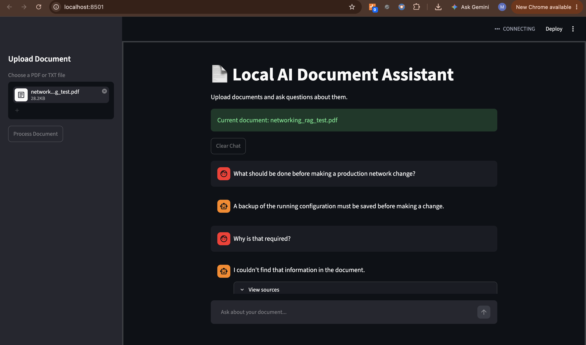
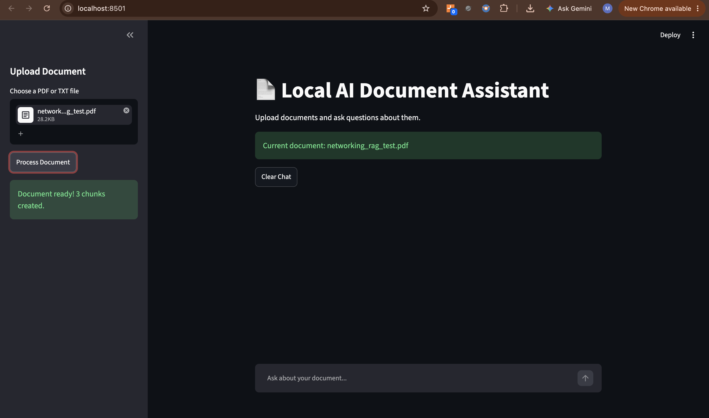
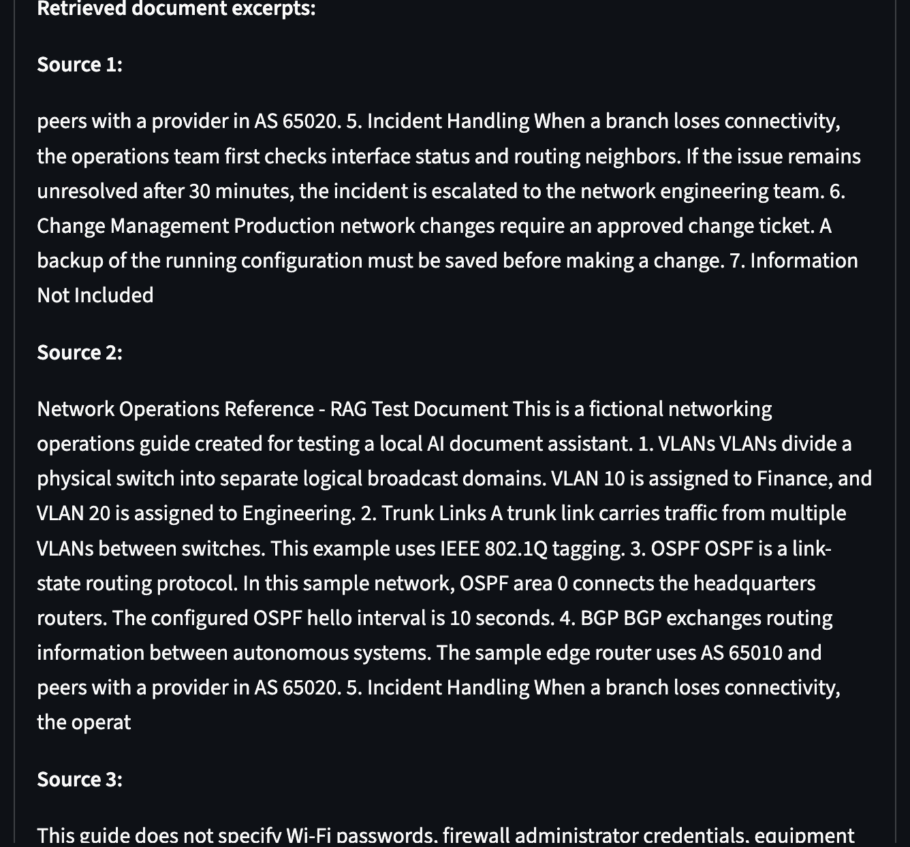

# Local AI Document Assistant

A privacy-focused AI chatbot that answers questions from uploaded PDF and TXT documents using Retrieval-Augmented Generation (RAG).

The application runs locally without paid AI APIs.

## Application Screenshots

### Main Interface


### Document Upload


### Question and Answer


### Source Evidence



## Features

- Upload PDF and TXT documents
- Ask questions about document contents
- Conversational follow-up questions
- Semantic search using ChromaDB
- Local embeddings using Ollama
- AI-generated answers with source excerpts
- Basic checks to reduce unsupported answers
- Streamlit chat interface

## Tech Stack

- Python
- Streamlit
- Ollama
- Qwen 2.5 (1.5B)
- Nomic Embed Text
- ChromaDB
- PyPDF

## How It Works

1. Upload a document.
2. Extract its text.
3. Split the text into smaller chunks.
4. Generate embeddings locally.
5. Store embeddings in ChromaDB.
6. Retrieve relevant chunks for each question.
7. Generate an answer using a local LLM.
8. Display the answer and retrieved sources.

## Installation

Install Python and Ollama.

Download the required models:

```bash
ollama pull qwen2.5:1.5b
ollama pull nomic-embed-text
```

Clone the repository:

```bash
git clone YOUR_REPOSITORY_URL
cd personal-ai-chatbot
```

Create a virtual environment:

```bash
python3 -m venv .venv
source .venv/bin/activate
```

Install dependencies:

```bash
pip install -r requirements.txt
```

Run the application:

```bash
streamlit run app.py
```

## Limitations

- Scanned PDFs without selectable text are not supported.
- Small language models may produce incomplete or incorrect answers.
- Follow-up question handling is not always reliable.
- The application processes one active document at a time.

## Privacy

Document processing, embeddings, and AI inference run locally through Ollama. No paid cloud AI API is required.

## Future Improvements

- Multiple-document search
- Better citation accuracy
- Improved conversational memory
- Support for scanned PDFs
- Automated evaluation tests
